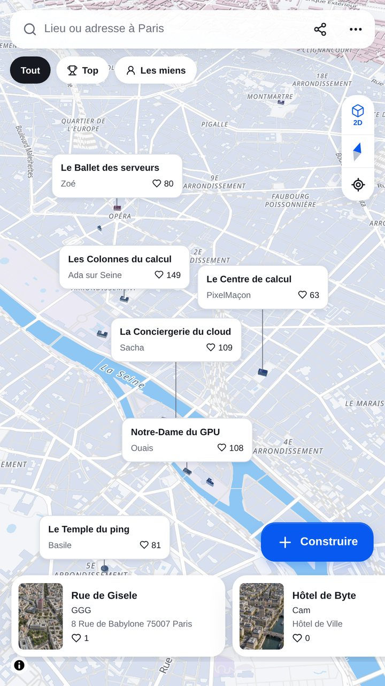
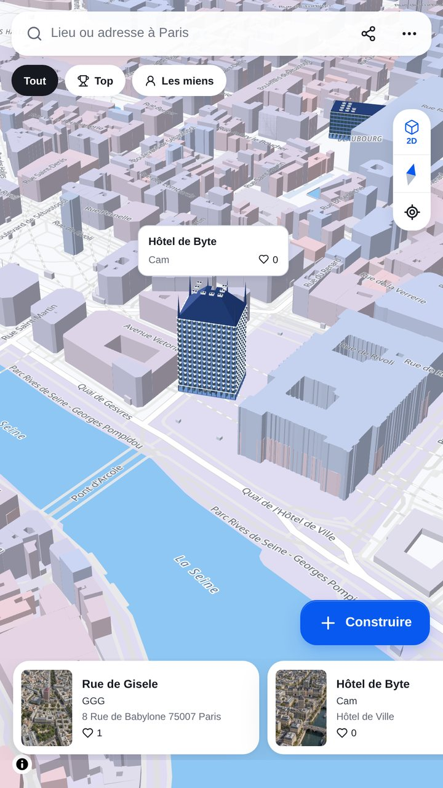
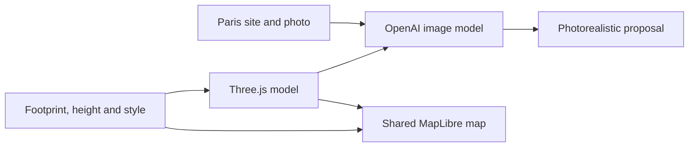

# Le Corbusier

Choose a place in Paris. Design a data center for it. Publish it on the shared map.

<a href="https://keff.uk/corbs/">Open the game</a>

## Design a building in 3D

Draw a footprint anywhere in Paris, set its height, choose one of ten styles and a color palette. Styles include Haussmann, Art Deco, Art Nouveau, Baroque, Rococo, Gothic Revival, classical, neoclassical, brutalist and contemporary. The model updates as you edit it, with floors, windows, server racks and cooling equipment.

The model is built in metres with Three.js. Its saved footprint uses real Paris coordinates. A custom MapLibre layer places every published model into the shared city view, using the same map camera and depth as the surrounding buildings.

The 3D model is the editable design. OpenAI uses its image, dimensions and the site's real photo to create a photorealistic view. The image can add material detail, while the saved model keeps the chosen shape and position.

## OpenAI models

- `gpt-5.4-mini` writes a site-specific design brief, caption, optional instructions and name ideas.
- `gpt-image-2.5-sunburst` creates the image from the real site photo and the player's 3D model.
- `omni-moderation-latest` checks the builder name, creation title and instructions.

## Play together

- Find a landmark or address, or choose any point on the map.
- Pick from ten architectural styles and adjust the design with your own instructions.
- Publish without creating an account. Your name and the building's name are required.
- Explore the shared map, vote for designs and browse the leaderboard.
- Open and share a creation page, compare its reference photo and result, or export an image.
- Install the PWA. Previously viewed parts of the map and public images are available offline; creating and publishing need a connection.
- Use the app in English or French.

## Data and credits

The map uses [OpenFreeMap](https://openfreemap.org/) tiles based on OpenStreetMap data. Address search and aerial references use the French IGN Géoplateforme. Landmark photographs keep their own licenses and credits; see the [photo catalog](data/places.json).

Creations are playful architectural concepts, not engineering plans or building permits. The code is licensed under [MIT](LICENSE). Photograph licenses are separate.

Local development and deployment instructions are in [DEPLOYMENT.md](DEPLOYMENT.md).
